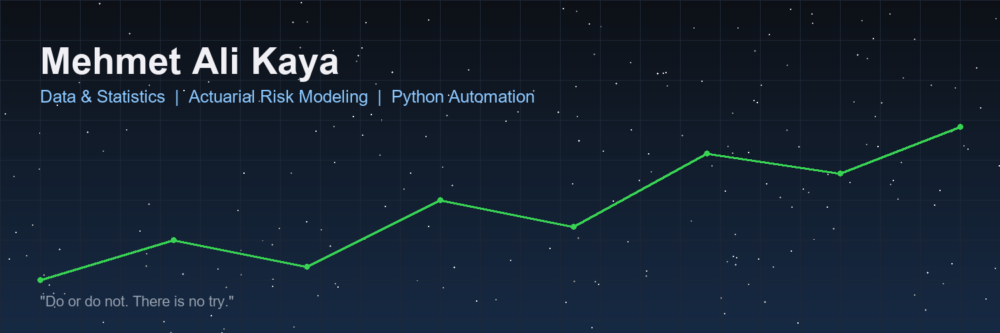
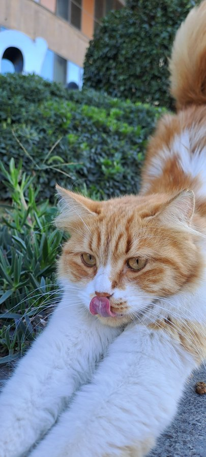

  

# Mehmet Ali Kaya

### Data Management | Applied Statistics | Actuarial Risk Research | Python Automation

**Data Management Office Specialist at Bupa Acıbadem Sigorta** · **Ph.D. Candidate in Management Information Systems** · **M.Sc. in Statistics**

I work across data management, applied statistics, and quantitative risk research. My focus is on reliable reporting, reproducible analysis, and small Python tools that make data workflows easier to inspect, validate, and maintain.

  
  
  

---

## Profile

My professional work centers on data-management operations and corporate-efficiency reporting. Alongside that work, my academic interests include applied statistics, actuarial analytics, quantitative risk methods, and reproducible computational research.

I build and document independent Python projects with an emphasis on clear inputs, explicit assumptions, safe file handling, and verifiable outputs. The repositories below include both research prototypes and small educational utilities; their maturity and limitations are stated rather than implied.

## Technical focus

  
  
  
  
  
  
  

- **Data management and reporting:** data quality checks, repeatable transformations, spreadsheet workflows, and clear reporting.
- **Applied statistics and quantitative research:** statistical evaluation, portfolio-analysis concepts, and reproducible experiments.
- **Actuarial-risk research:** OU-SDE parameterization, HMM/GMM regime analysis, extreme-value methods, and VaR/TVaR-style measures in a research-code context.
- **Python automation:** CSV/JSON conversion, validation utilities, text processing, and non-destructive file operations.
- **Machine learning practice:** classical classification and clustering, a small PyTorch classifier, and an optional Hugging Face inference example using documented third-party models.

### Methods used in selected research code

  
  
  
  

These labels describe methods explored in specific repositories; they are not certifications or claims that the models are validated for regulatory, clinical, investment, or production decisions.

## Selected projects

| Project | What it does | Scope |
|---|---|---|
| [**BIOGAS RS-PIM Engine**](https://github.com/000MAK/biogas-rspim-engine) | Research pipeline for biogas-output data, OU-SDE parameterization, HMM/GMM regime comparisons, extreme-value fitting, risk measures, and report generation | Research/academic prototype. Bring permitted data, verify assumptions, and perform domain validation before interpreting results. |
| [**Quantix — 100 Mini Python Projects**](https://github.com/000MAK/quantix-100-new-mini-projects) | Collection of focused command-line utilities with source code, examples, and tests, plus a separate educational ML/DL lab | See the project index and individual READMEs for each tool's behavior and limitations. |
| [**Applied ML & DL Lab**](https://github.com/000MAK/quantix-100-new-mini-projects/tree/main/ml-dl-lab) | Wine classification, synthetic clustering, a small PyTorch digits classifier, and optional English sentiment inference with an attributed Hugging Face model | Educational baselines, not production ML services. Model scores should not be treated as calibrated high-stakes probabilities. |
| [**Mini CSV Cleaner**](https://github.com/000MAK/mini-csv-cleaner) | Trims cell whitespace, skips fully blank rows, and optionally removes exact duplicate rows after trimming | Python standard library; includes unit tests and refuses to overwrite an existing output. |
| [**Mini JSON ↔ CSV Converter**](https://github.com/000MAK/mini-json-csv-converter) | Converts JSON arrays of objects to CSV and CSV records to JSON | Python standard library; inspect the documented input shape and tests before using it in a workflow. |
| [**Mini Log Redactor**](https://github.com/000MAK/mini-log-redactor) | Applies pattern-based redaction to common token-like strings in diagnostic logs | Best-effort hygiene only; it cannot guarantee that every secret is detected. Review output before sharing. |

### Additional research artifact

[**PXU030 Portfolio Optimization**](https://github.com/000MAK/PXU030Portfoliooptimization) contains a saved HTML artifact associated with minimum-variance portfolio analysis over daily data from 2020-01-01 to 2022-12-02. The repository's end-to-end data provenance and reproducibility details remain incomplete; it should not be treated as an independently reproducible benchmark or as investment advice.

## Engineering principles

- **Reproducibility:** document inputs, assumptions, steps, and dependencies.
- **Data integrity:** preserve source files and avoid silent, ambiguous transformations.
- **Validation:** test deterministic behavior and compare outputs against explicit expectations.
- **Privacy and safety:** never publish customer data, credentials, or confidential files.
- **Honest scope:** distinguish working examples, research prototypes, and future ideas.

## Beyond the keyboard

Martial arts have taught me to value steady practice, controlled execution, and fundamentals: **Taekwondo — 2nd Dan · Muay Thai — 4th Khan · Kickboxing — green belt · Brazilian Jiu-Jitsu — white belt · Level 1 Assistant Coach.**

  
   
  Simba's contribution to code review: morale and scheduled breaks. 🐾

## GitHub activity

  
  

  

Activity cards are rendered by third-party services and may be temporarily unavailable. The contribution animation depends on the repository's scheduled GitHub Actions workflow.

## Connect

- **GitHub:** [@000MAK](https://github.com/000MAK)
- **Hugging Face:** [makactuary](https://huggingface.co/makactuary)
- **LinkedIn:** [Mehmet Ali Kaya](https://www.linkedin.com/in/mehmet-ali-kaya97/)
- **All public repositories:** [Browse projects](https://github.com/000MAK?tab=repositories)

---

Think rigorously. Build reproducibly. Document the limitations.

