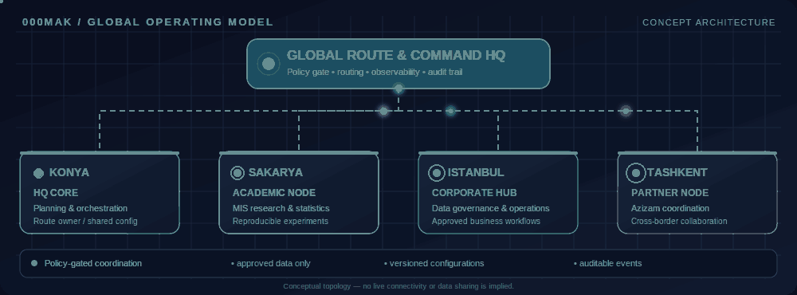

<p align="center">
  
</p>

<div align="center">

# Hi, I'm Mehmet Ali Kaya 👋

**Data Management Office Specialist · Ph.D. Candidate in Management Information Systems · M.Sc. in Statistics**

I work at the intersection of data governance, applied statistics, actuarial risk modeling, and reproducible Python automation. I enjoy combining rigorous quantitative methods with practical engineering—and bringing the same patience and discipline to research, code, and martial arts.

<p>
  
</p>

[](https://github.com/000MAK)
[](https://github.com/000MAK?tab=repositories)
[](https://huggingface.co/makactuary)
[](https://www.linkedin.com/in/mehmet-ali-kaya97/)

</div>

---

## 🌐 Global Route & Command HQ

<p align="center">
  
</p>

<p align="center">
  
</p>

<p align="center"><sub>Editable SVG sources: <a href="assets/global-hq-network.svg">network diagram</a> · <a href="assets/badge-konya.svg">Konya</a> · <a href="assets/badge-sakarya.svg">Sakarya</a> · <a href="assets/badge-istanbul.svg">Istanbul</a> · <a href="assets/badge-tashkent.svg">Tashkent / Azizam</a>.</sub></p>

### Multi-node topology

```text
                    +--------------------------------------+
                    |       GLOBAL ROUTE & COMMAND HQ      |
                    |   Policy Gate | Routing | Audit      |
                    +--------------------+-----------------+
                                         |
             +---------------------------+---------------------------+
             |                           |                           |
      +------+-------+            +------+-------+            +------+-------+
      | KONYA        |            | SAKARYA      |            | ISTANBUL     |
      | HQ CORE      |            | ACADEMIC     |            | CORPORATE    |
      | Planning     |            | MIS / Stats  |            | Data Quality |
      +--------------+            +--------------+            +------+-------+
                                                                       |
                                                             Approved hand-off
                                                                       |
                                                               +-------+------+
                                                               | TASHKENT     |
                                                               | AZIZAM NODE  |
                                                               | Partnership  |
                                                               +--------------+
```

| Node | Role | Focus |
|---|---|---|
| **Konya** | HQ core | Coordination, route planning, and versioned configuration |
| **Sakarya** | Academic node | Management Information Systems research, statistics, and reproducibility |
| **Istanbul** | Corporate hub | Data governance concepts, quality controls, and approved operational workflows |
| **Tashkent** | Azizam partner node | Cross-border coordination and partner workflow hand-offs |

**Control plane:** documented policies, coordination, versioned configuration, and auditable events.  
**Data plane:** approved access, least privilege, and source-system ownership. Work status and metadata can be coordinated without automatically copying sensitive datasets.

> **Scope note:** This is a conceptual portfolio architecture, not a claim of live network connectivity, physical headquarters at every node, active system integration, or authorization to exchange confidential data. “Azizam” is the partnership label supplied for this profile; the partnership details have not been independently verified.

---

## 🧠 Technical focus

<p align="center">
  
</p>

- **Statistics & actuarial analytics:** stochastic modeling, risk analysis, tail-risk concepts, portfolio optimization, and quantitative evaluation.
- **Machine learning & deep learning:** classical classification, clustering, neural-network practice, and transformer-based inference experiments.
- **Data engineering:** deterministic transformations, CSV/JSON utilities, validation, quality reporting, and privacy-conscious automation.
- **Research discipline:** transparent assumptions, reproducibility, meaningful baselines, and honest reporting of limitations.

## 🧬 Selected projects

*These links point to repositories that currently exist. Descriptions are deliberately limited to the documented scope of each project.*

| Project | What it explores | Status / notes |
|---|---|---|
| [**biogas-rspim-engine**](https://github.com/000MAK/biogas-rspim-engine) | Research-oriented biogas output and actuarial-risk modeling, including OU-SDE calibration, HMM regime analysis, EVT tail fitting, and solvency-style metrics | Research/academic code; validate assumptions and runtime against your own data before operational use |
| [**Quantix — ML/DL Lab**](https://github.com/000MAK/quantix-100-new-mini-projects/tree/main/ml-dl-lab) | Wine classification, synthetic clustering, a PyTorch digits classifier, and optional Hugging Face sentiment inference | Offline examples are available; external pretrained-model inference requires its documented dependencies and model download |
| [**quantix-100-new-mini-projects**](https://github.com/000MAK/quantix-100-new-mini-projects) | Small Python CLI utilities and learning projects, including data processing, validation, file operations, and a consent-gated ingestion demo | See the repository README and tests for per-tool details |
| [**PXU030Portfoliooptimization**](https://github.com/000MAK/PXU030Portfoliooptimization) | Minimum-variance portfolio optimization and efficient-frontier analysis | Statistics research artifact; historical analysis is not investment advice |
| [**mini-csv-cleaner**](https://github.com/000MAK/mini-csv-cleaner) | Non-destructive CSV cleanup with optional de-duplication | See README for supported input formats and usage |
| [**mini-json-csv-converter**](https://github.com/000MAK/mini-json-csv-converter) | Bidirectional JSON and CSV conversion | See repository tests and examples |
| [**mini-log-redactor**](https://github.com/000MAK/mini-log-redactor) | Best-effort redaction of common secret-like patterns in logs | Redaction is not a guarantee; review outputs before sharing |

### 🔬 Research ideas on the roadmap

The following are **ideas, not existing published repositories**. They should only be linked as repositories after implementation and review:

- **martial-arts-pose-ml** — pose-based movement classification using appropriately licensed data, with a clear distinction between movement labels and medical conclusions.
- **actuarial-evt-dl** — an EVT-centered study comparing transparent statistical baselines with neural approaches for tail-risk research.
- **rl-portfolio-optimizer** — a research comparison between PPO and classical portfolio baselines with chronological evaluation and transaction-cost assumptions.

---

## 🐈 Simba's coding supervision log

<p align="center">
  
</p>

<p align="center"><em>“Clean data, deterministic code, and properly scheduled treats.” — Simba 🐾</em></p>

## 🥋 Discipline beyond the terminal

**Taekwondo:** 2nd Dan black belt · **Muay Thai:** 4th Khan · **Kickboxing:** green belt · **Brazilian Jiu-Jitsu:** white belt · **Coaching:** Level 1 Assistant Coach

Martial arts and quantitative work both reward controlled execution, consistent practice, careful observation, and getting the fundamentals right before increasing complexity.

## 📊 GitHub activity

<p align="center">
  
  
</p>

<p align="center">
  
</p>

<p align="center">
  
</p>

<sub>Stats, trophies, typing text, and contribution animations depend on third-party services and GitHub Actions. They may be temporarily unavailable and are not official GitHub analytics. The contribution animation appears after its workflow successfully generates the file.</sub>

## 🌍 Remote collaboration

Interested in remote-friendly work involving data management, analytics, statistical modeling, Python automation, and reproducible research. **English: C1 (self-reported).**

I value clear documentation, privacy-aware workflows, measurable assumptions, thoughtful code review, and communication across disciplines.

## 🔗 Connect

- **GitHub:** [@000MAK](https://github.com/000MAK)
- **Hugging Face:** [makactuary](https://huggingface.co/makactuary)
- **LinkedIn:** [Mehmet Ali Kaya](https://www.linkedin.com/in/mehmet-ali-kaya97/)
- **Repositories:** [Browse all public projects](https://github.com/000MAK?tab=repositories)

---

<p align="center"><sub>Think rigorously. Build reproducibly. Practice consistently. Keep Simba supplied with treats.</sub></p>
